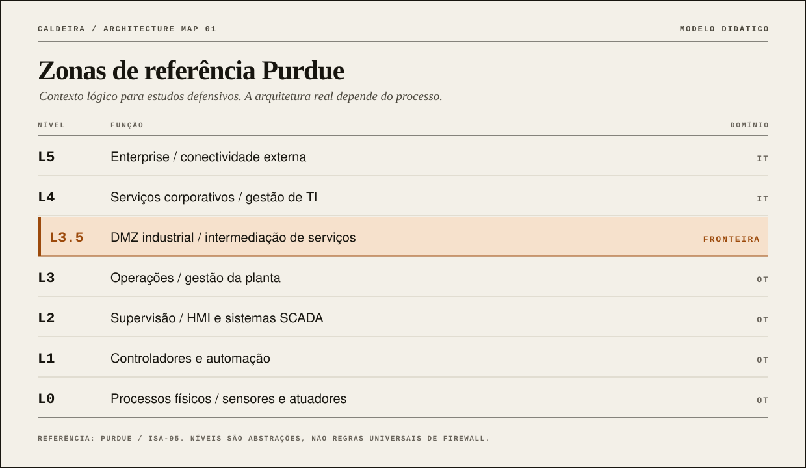

<div align="center">

<a href="COMECE-AQUI.md"></a>

<br>

[](COMECE-AQUI.md)
[](docs/casos-ot/README.md)
[](core/evidence.py)
[](tests/test_core.py)

### Threat intelligence is not just a report. Detection is not just an alert.

**Caldeira Cyber OT Labs** é um hub independente de estudos globais sobre **OT / ICS / SCADA**, com um núcleo didático de **detecção baseada em eventos sintéticos, evidências verificáveis e inteligência aplicada**.

[**COMECE AQUI**](COMECE-AQUI.md) · [**ABRIR PORTAL VISUAL**](docs/PORTAL.md) · [**CASOS DE DETECÇÃO**](cases/README.md) · [**ATLAS DE INCIDENTES**](docs/casos-ot/README.md) · [**ARQUITETURA**](docs/arquitetura-labs.md)

</div>

---

> [!IMPORTANT]
> **Status real do projeto.** Implementado: dois detectores puros, runner local offline, fixtures sintéticas, digest SHA-256 e testes. OpenPLC, GRFICS, ScadaBR, Conpot e outros backends são **pesquisa e integração futura**, não funcionalidades disponíveis. O repositório [Mininet](https://github.com/Ridd1kulusC0d3r/mininet) é independente e é citado apenas como referência.
>
> **Safety first:** nenhuma operação neste repositório interage com sistemas OT reais. Nada aqui se destina a produção ou decisão automática sobre processo físico.

## 01 / An industrial intelligence workbench

<table><tr>
<td width="50%" valign="top">

###  Global OT Research

Atlas de casos, relatórios anuais, fontes primárias, pesquisadores, fornecedores, ameaças, standards e metodologia de CTI industrial.

**[Explorar atlas →](docs/casos-ot/README.md)**

</td>
<td width="50%" valign="top">

###  Detection & Evidence

Regras puras sobre metadados fictícios, validação de baseline, resultados explicáveis, fixtures reproduzíveis e digest SHA-256.

**[Executar casos offline →](COMECE-AQUI.md)**

</td>
</tr></table>

## 02 / Architecture at a glance

<div align="center">

</div>

| Camada | Recurso | Estado |
|:---|:---|:---|
| **INTELLIGENCE** | [Atores, ferramentas e técnicas documentadas](core/intel/README.md) | Catálogo editorial |
| **DETECTION CORE** | [Modbus policy](core/detectors/ot/modbus.py) · [IT/OT boundary](core/detectors/it/boundary.py) | **Implementado** |
| **EVIDENCE ENGINE** | [JSON canônico e SHA-256](core/evidence.py) | **Implementado** |
| **OFFLINE RUNNER** | [Análise de fixtures](core/runner.py) | **Implementado** |
| **SIM BACKENDS** | [OpenPLC, GRFICS, Conpot e outros](sims/README.md) | **Planejados / não integrados** |
| **EXTERNAL LAB** | [Mininet / Mininet-Sec](https://github.com/Ridd1kulusC0d3r/mininet) | **Projeto distinto** |

## 03 / First detections

<details open>
<summary><b>CAL-LAB-001 · Solicitação de escrita Modbus fora da política</b></summary>

Analisa eventos *fictícios* de leitura/escrita e verifica uma matriz de origens autorizadas. A detecção retorna uma **hipótese** de comando não autorizado [T1692.001](https://attack.mitre.org/techniques/T1692/001/), sem afirmar que houve ação física ou incidente real.

**Resultado esperado:** 1 alerta reproduzível. [Ver fixture](cases/fixtures/modbus-policy.json).

</details>
<details>
<summary><b>CAL-LAB-002 · Fluxo IT→OT fora da matriz de zonas</b></summary>

Analisa somente metadados de uma fronteira fictícia IT/OT. Um desvio de política não prova movimento lateral, intrusão ou pivô. Por isso **nenhuma técnica ATT&CK é atribuída automaticamente**.

**Resultado esperado:** 1 alerta reproduzível. [Ver fixture](cases/fixtures/boundary-policy.json).

</details>

### Run it (offline, no dependencies)

```bash
python -m unittest discover -s tests -v
python -m core.runner cases/fixtures/modbus-policy.json
python -m core.runner cases/fixtures/boundary-policy.json
```

**SHA-256 mede integridade, não autenticidade.** A validação indica se o payload difere do digest fornecido, mas não atesta quem gerou o arquivo. [Ver documentação](docs/arquitetura-labs.md).

## 04 / Threat intelligence & technique accuracy

A matriz ATT&CK for ICS é **taxonomia de comportamentos**, não detector automático nem comprovação de autorias.

| Contexto | Estudo / técnica |
|---|---|
| Parâmetros industriais | [T0836 · Modify Parameter](https://attack.mitre.org/techniques/T0836/) |
| Mensagem de comando não autorizada | [T1692.001 · Command Message](https://attack.mitre.org/techniques/T1692/001/) |
| Mudança de modo do controlador | [T0858 · Change Operating Mode](https://attack.mitre.org/techniques/T0858/) |
| Atualização de programa | [T0843 · Program Download](https://attack.mitre.org/techniques/T0843/) |
| Descoberta remota | [T0846 · Remote System Discovery](https://attack.mitre.org/techniques/T0846/) |

> Correção editorial 2026: os IDs antigos `T0855` e `T0857` não devem ser usados sem conferir o catálogo atual. `T0842` se refere a **Network Sniffing** e `T0813` a **Denial of Control**, conceitos distintos da descoberta e da mudança de modo. [Ver catálogo revisado](core/intel/README.md).

## 05 / Global research atlas

| Coleção | Conteúdo | Link |
|:---|:---|:---|
| **Incident Atlas** | BlackEnergy, Industroyer, TRITON, INCONTROLLER, Industroyer2, FrostyGoop, JBS | [Dossiês e ressalvas](docs/casos-ot/README.md) |
| **Reports** | Fortinet 2026 + séries e relatórios internacionais | [Biblioteca](relatorios/README.md) |
| **Vendors** | Dragos, Nozomi, Claroty, Fortinet, Tenable, Armis, TXOne, Cisco | [Landscape](docs/ecossistema/fornecedores.md) · [Matriz neutra](docs/ecossistema/avaliacao-fornecedores.md) |
| **Standards** | ISA/IEC 62443, Purdue/ISA-95, NIST, MITRE, CISA e SANS ICS | [Mapa de referenciais](docs/referenciais-ot.md) · [Instituições](docs/ecossistema/instituicoes.md) |
| **Datasets** | Fontes, licenças, limitações de aplicação | [Datasets](docs/datasets-ot.md) |
| **Researchers** | Robert M. Lee, Joe Slowik, Dale Peterson e comunidade | [Pesquisadores](docs/ecossistema/especialistas.md) |
| **UtilSec · Curated** | 10 repositórios revisados: referências aprovadas, duplicações e fontes em triagem | [Curadoria crítica](docs/ecossistema/utilsec-curadoria.md) |
| **Telemetry** | Conceitos dos protocolos industriais e observabilidade | [Protocolos](docs/protocolos-telemetria.md) |
| **Evidence-Based CTI** | Proveniência, hipóteses, confiança e revisão | [Metodologia](docs/metodologia-cti-ot.md) |

### OT standards & mitigations · Curadoria expandida

| Referência | Para estudar | Aplicação no Caldeira |
|:---|:---|:---|
| **[ISA/IEC 62443](docs/referenciais-ot.md)** | Famílias de requisitos para programas, sistemas e componentes IACS | Avaliar necessidades de arquitetura, governança e ciclo de vida |
| **[Purdue + ISA-95](docs/arquitetura-labs.md)** | Funções industriais, fronteiras e integração entre sistemas | Compreender zonas didáticas, sem impor topologia universal |
| **[MITRE ATT&CK for ICS](core/intel/README.md)** | Comportamentos adversários documentados | Hipóteses de detecção com evidências verificáveis |
| **[NIST SP 800-82](docs/ecossistema/instituicoes.md)** | Segurança, desempenho, confiabilidade e safety | Orientação defensiva e análise de risco |
| **[CISA · Five Primary Mitigations](docs/guias/cisa-mitigacoes-ot.md)** | Exposição, credenciais, acesso remoto, segmentação, operação manual | Checklist de discussão com engenharia OT |
| **[SANS ICS](docs/ecossistema/instituicoes.md)** | Formação técnica e Five Critical ICS Controls | Trilha de aprendizagem profissional |

**Atenção:** requisitos normativos, recomendações, taxonomias e claims comerciais não são equivalentes. [Leia a análise e as fontes oficiais](docs/referenciais-ot.md).

## 06 / Report spotlight · Fortinet 2026

| Indicador da pesquisa global | Valor informado |
|---|---:|
| Respostas relatando 1–9 invasões no ano | **71%** |
| Esperam maior regulamentação nos próximos cinco anos | **89%** |
| Declaram cobertura de visibilidade OT de 100% | **14%** |
| Reportam interrupção operacional com impacto na receita | **46%** |

Estes números vêm de **respostas em uma amostra**, não representam taxas universais. [Análise crítica com páginas](relatorios/fortinet/2026-state-of-ot-cybersecurity.md) · [Fonte oficial](https://www.fortinet.com/resources/reports/state-ot-cybersecurity).

## 07 / Contribute to better OT research

Evidência primária > alegação de vendor. Consequência real > inferência de impacto. Técnica documentada > associação por semelhança. Segurança de processo > automação irrefletida.

[Guia de contribuição](CONTRIBUTING.md) · [Referenciais OT](docs/referenciais-ot.md) · [Critérios de escopo](docs/separacao-de-escopos.md) · [Identidade visual](assets/brand/BRAND.md) · [Portal HTML](docs/PORTAL.md)

---

<div align="center">
<sub>CALDEIRA CYBER OT LABS · RESEARCH • DETECT • VERIFY • LEARN</sub><br>
<sub>Projeto independente; sem afiliação com Dragos, MITRE ou os fornecedores citados.</sub>
</div>
