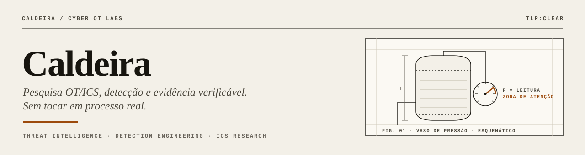
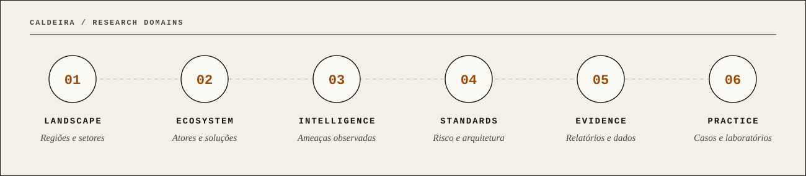
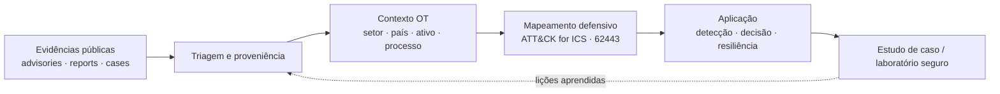

 

**GLOBAL OT/ICS THREAT INTELLIGENCE · RESEARCH · RESILIENCE**

**Uma base global e independente para estudar, contextualizar e defender sistemas ciberfísicos.**

[Explorar conhecimento](docs/index.md) · [Relatórios e análises](relatorios/README.md) · [Fornecedores](docs/ecossistema/fornecedores.md) · [Instituições e normas](docs/ecossistema/instituicoes.md) · [Estudos aplicados](labs/README.md)

---

> [!IMPORTANT]
> **Segurança operacional primeiro.** Este projeto é educativo e defensivo; não é afiliado à Dragos ou a fornecedores mencionados. Evidências comerciais, pesquisas de mercado e normas oficiais são identificadas separadamente. Nenhuma recomendação deve ser aplicada a uma planta real sem validação da engenharia, segurança de processo e responsáveis operacionais.

## 01 / Mission control

O **Caldeira Cyber OT** investiga a interseção entre **OT (Operational Technology), ICS (Industrial Control Systems), SCADA, inteligência de ameaças (CTI), segurança de processo e resiliência de infraestruturas críticas**. O objetivo é transformar fontes fragmentadas em conhecimento rastreável, comparável e útil para defender operações em diferentes países e setores.

| DIMENSÃO | OBJETIVO | ENTREGA |
|:---|:---|:---|
| **01 · Landscape** | Compreender o cenário global e as diferenças regionais | [Panorama global](docs/panorama-global.md) |
| **02 · Ecosystem** | Comparar atores, fornecedores, pesquisas e instituições | [Fornecedores](docs/ecossistema/fornecedores.md) · [Pesquisadores](docs/ecossistema/especialistas.md) |
| **03 · Intelligence** | Diferenciar atividade observada, hipótese e tendência | [Ameaças e análise](docs/inteligencia-ameacas.md) |
| **04 · Standards** | Relacionar arquitetura e gestão de risco às normas | [Instituições e referenciais](docs/ecossistema/instituicoes.md) |
| **05 · Evidence** | Curar relatórios e analisar metodologia e vieses | [Biblioteca de relatórios](relatorios/README.md) |
| **06 · Practice** | Traduzir estudos em cenários seguros de laboratório | [Laboratórios e casos](labs/README.md) |

## 02 / OT research radar

### Comece pela edição 2026

**[Fortinet — Relatório 2026 sobre o Estado da Tecnologia Operacional e Cibersegurança](relatorios/fortinet/2026-state-of-ot-cybersecurity.md)**

Estudo global com mais de 700 profissionais relacionados a OT. A análise independente do Caldeira cobre governança, maturidade, visibilidade, intrusões, regulamentação e recomendações, com **páginas de origem e ressalvas metodológicas**.

| DADO DO RELATÓRIO | 2026 | INTERPRETAÇÃO CORRETA |
|:---|---:|:---|
| Respostas indicando 1–9 invasões no ano | **71%** | Frequência *relatada* na amostra, não incidência universal |
| Esperam aumento regulatório em até 5 anos | **89%** | Expectativa dos entrevistados, não previsão legal confirmada |
| Relataram visibilidade de 100% dos sistemas OT | **14%** | Autoavaliação de visibilidade, não inventário auditado |
| Reportaram interrupções com impacto na receita | **46%** | Proporção declarada no levantamento |

Fonte: [Fortinet 2026 — página oficial do relatório](https://www.fortinet.com/resources/reports/state-ot-cybersecurity). Análise e remissão à paginação em [relatorios/fortinet](relatorios/fortinet/2026-state-of-ot-cybersecurity.md).

## 03 / Global knowledge map

| CAMADA | ÁREAS DE ESTUDO |
|:---|:---|
| **Ambientes** | Manufatura, energia, água, óleo e gás, transporte, saúde, edifícios |
| **Ativos** | PLC/CLP, RTU, HMI, EWS, historiadores, DCS, SCADA, SIS |
| **Redes** | Segmentação, zonas e conduítes, acesso remoto, telemetria passiva |
| **Ameaças** | Ransomware com impacto operacional, intrusões, engenharia social, exposição de fornecedores |
| **Resiliência** | Gestão de ativos, monitoramento, resposta a incidentes, recuperação e continuidade |
| **Governança** | ISA/IEC 62443, MITRE ATT&CK for ICS, NIST SP 800-82, orientações nacionais |

### Arquitetura conceitual

## 04 / Navegação

- **[Introdução e trilhas](docs/index.md)**: o que estudar e em qual ordem.
- **[Panorama global](docs/panorama-global.md)**: regiões, setores e convergência IT/OT.
- **[Fornecedores e soluções](docs/ecossistema/fornecedores.md)**: Dragos, Nozomi, Claroty, Fortinet e Tenable.
- **[Especialistas e comunidade](docs/ecossistema/especialistas.md)**: Robert M. Lee, Joe Slowik e Dale Peterson.
- **[Organizações e normas](docs/ecossistema/instituicoes.md)**: ISA, MITRE, NIST, CISA e autoridades internacionais.
- **[Inteligência e evidências](docs/inteligencia-ameacas.md)**: taxonomia analítica e limitações.
- **[Relatórios](relatorios/README.md)**: curadoria, indexação, síntese e metodologia.
- **[Cenários didáticos](labs/README.md)**: exercícios defensivos isolados e observação de tráfego sintético.
- **[Identidade visual](assets/brand/BRAND.md)**: linguagem gráfica, cores e regras.
- **[Como contribuir](CONTRIBUTING.md)**: qualidade das evidências e estrutura de submissão.

## 05 / Regras editoriais

1. **Fonte primária antes de marketing.** Preferir norma, advisory oficial, telemetria publicada e documentação original.
2. **Data importa.** Diferenciar *ano publicado*, *ano dos dados* e *ano do incidente*.
3. **Inferência não é fato.** Separar número observado, interpretação, hipótese e recomendação.
4. **Escopo global de verdade.** Não extrapolar uma amostra corporativa para todos os países e setores.
5. **Safety by design.** Nunca orientar testes ativos em redes industriais sem autorização e aprovação operacional.
6. **Direitos autorais.** Referenciar relatórios externos e publicar somente análises originais quando não houver licença de redistribuição.

---

<strong>CALDEIRA CYBER OT</strong> 
Industrial processes are physical. Evidence must be verifiable.  
<a href="https://github.com/Ridd1kulusC0d3r/CaldeiraCyberOT">GitHub</a> · <a href="relatorios/README.md">Research archive</a> · <a href="CONTRIBUTING.md">Contribute</a>

